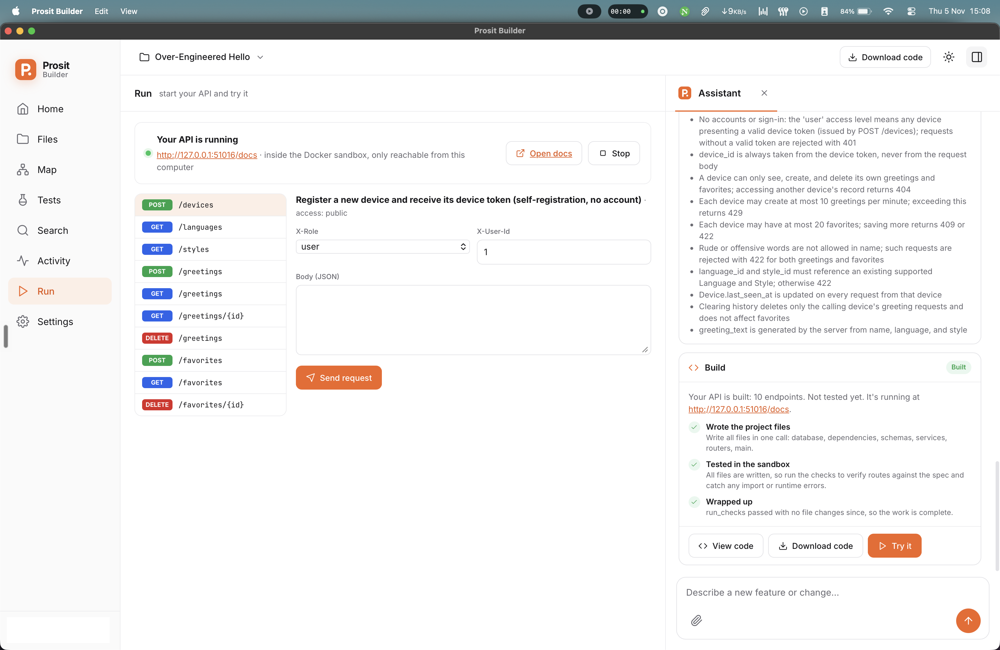
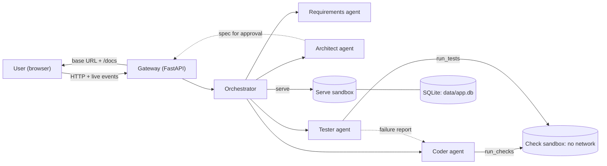

# PROSIT 2: Plain-Language API Builder

ICS554 Natural Language Processing · Ashesi MSc Intelligent Computing Systems · Group 3

A non-developer describes a backend in plain words. A team of AI agents built on the **Claude Agent SDK** turns it into a running, tested API with its own SQLite database and a Swagger page to try it out.

```
"I run a small clinic. I need to book patients into appointments."
        │
        ▼
Requirements ──► Architect ──► [user approves the plan] ──► Coder ⇄ Tester
        │
        ▼
http://localhost:8101/docs    running API · tests passing · data saved in SQLite
```

> **Status:** SDK rebuild in progress. The first hand-built prototype is archived (see [Baseline](#baseline-the-hand-built-prototype)). Commands below describe the target structure; update this file as parts land.

## Contents

1. [Sample UI](#sample-ui)
1. [What we are building](#what-we-are-building)
2. [Architecture](#architecture)
3. [Sandbox and security](#sandbox-and-security)
4. [Generated APIs and SQLite](#generated-apis-and-sqlite)
5. [Shared contracts](#shared-contracts-day-1-agreements)
6. [Repository layout](#repository-layout)
7. [Getting started](#getting-started)
8. [Team roles](#team-roles)
9. [Milestones](#milestones)
10. [Project checklist](#project-checklist)
11. [Contributing](#contributing)
12. [Course topics in the system](#course-topics-in-the-system)
13. [Baseline: the hand-built prototype](#baseline-the-hand-built-prototype)
14. [Known limitations](#known-limitations)

---

## Sample UI

**Prosit Builder** is the target interface. It comes from the hand-built prototype and is the reference Role 1 builds toward for the SDK version.



*The Run view after a build: the API is running in the Docker sandbox on a localhost port, every endpoint can be tried from the left list, and the Assistant panel shows the approved rules and each build step.*

The window has three parts: a sidebar of views, the main panel, and the Assistant panel on the right, which can be toggled.

| View | Shows |
| --- | --- |
| **Home** | Code editor for the generated project |
| **Files** | The project's files in the workspace |
| **Map** | How the API's modules import each other, drawn as layered columns |
| **Tests** | Every test the Tester ran, grouped by file, with the pass count |
| **Search** | Search inside the generated code |
| **Activity** | Every agent step, newest first |
| **Run** | Start and stop the API, open the Swagger docs, and send requests to any endpoint with headers and a JSON body |
| **Settings** | App settings |
| **Assistant** (panel) | The chat, the spec for approval, the rules in plain English, build progress, and the result card with **View code**, **Download code** and **Try it** |

The project menu at the top switches between generated projects, and **Download code** exports the whole project.

---

## What we are building

| | |
| --- | --- |
| **Input** | A plain-language description of a backend, plus follow-up messages ("actually, patients should only see their own appointments"). |
| **Output** | A running backend where every endpoint works, data persists in SQLite, a Swagger page at `/docs` for trying it, a list of endpoints, and the test results. |
| **Scope** | Backend only. Generating a frontend that uses the API is a future extension. |
| **Class rule** | The browser never talks to an agent directly. Every request goes through our backend, the same way a frontend never queries a database directly. |

---

## Architecture



### Components

| Component | What it does | Built with |
| --- | --- | --- |
| **UI** | Chat, spec approval screen, live build progress, "try it" panel | Static HTML/JS (`ui/`) |
| **Gateway** | Sessions, receives messages, streams events to the UI, proxies everything to the orchestrator | FastAPI + Server-Sent Events |
| **Orchestrator** | Runs the agents in order, handles approval and change requests, enforces stop rules, logs every step | Plain Python state machine |
| **Agents** | Requirements, Architect, Coder, Tester. Each one is its own SDK session with its own prompt, tools and permissions | `claude-agent-sdk` (`ClaudeSDKClient`) |
| **Custom tools** | `submit_spec`, `run_checks`, `run_tests`, `finish_build`, etc. | SDK `@tool`, served as an in-process MCP server |
| **Sandbox** | Runs generated code in locked-down Docker containers | Docker (`sandbox/`) |

### The build flow

1. **Understand.** The Requirements agent chats with the user, one question at a time, until it can submit a complete `Requirements` summary.
2. **Design.** The Architect turns the requirements into a `Spec`: entities, fields, endpoints, access rules and business rules. `submit_spec` validates it against the schema before accepting it.
3. **Approve.** The UI shows the spec in plain English. The user approves or requests a change, which goes back to the Architect. **No code is written before approval.**
4. **Build.** The Coder writes `app/` in the project workspace, calls `run_checks` until everything passes, then calls `finish_build`. The finish gate is enforced in code: `finish_build` is refused until checks have passed since the last file change.
5. **Test.** The Tester writes `tests/` from the **spec, not the code**, runs them, and submits a structured failure report if anything fails.
6. **Fix.** The failure report sends the Coder back into its loop (`MAX_FIX_ROUNDS`, default 1). The Coder cannot edit `tests/`. If a fix round breaks the build, the last working code is restored and the known failures are reported honestly.
7. **Deliver.** The orchestrator starts the API in the serve sandbox and returns a `BuildResult`: base URL, docs URL, endpoint list, test summary and any known failures.

Messages the user sends during a build are queued and shown in the chat. After the current agent step, the orchestrator routes them as change requests.

### Inside each agent

The SDK runs the Thought → Action → Observation loop for us. For each agent we supply the system prompt, the tools it may use, permission rules, hooks, and a turn limit.

| Agent | Goal | Tools | Done when |
| --- | --- | --- | --- |
| Requirements | Understand what the user wants | `ask_user`, `submit_requirements` | Requirements validate against the schema |
| Architect | Turn requirements into a spec | `submit_spec` | Spec validates and the user approves it |
| Coder | Build the API from the spec | `Read`, `Write`, `Edit`, `Glob`, `Grep` (workspace only), `run_checks`, `search_patterns`, `finish_build` | `finish_build` accepted |
| Tester | Find bugs | `Read`, `Glob`, `Grep`, `Write` (`tests/` only), `run_tests`, `submit_report` | All tests pass, or report submitted |

A sketch of how the Coder is configured (Role 3 owns the real version in `agents/coder.py`):

```python
options = ClaudeAgentOptions(
    model=os.getenv("LLM_MODEL", "claude-haiku-5-5"),
    system_prompt=CODER_PROMPT,
    cwd=workspace,                                    # file tools work inside the project
    mcp_servers={"prosit": prosit_tools},             # our custom tools
    allowed_tools=["Read", "Write", "Edit", "Glob", "Grep",
                   "mcp__prosit__run_checks", "mcp__prosit__search_patterns",
                   "mcp__prosit__finish_build"],
    disallowed_tools=["Bash", "WebFetch", "WebSearch"],
    hooks={"PreToolUse": [HookMatcher(matcher="Write|Edit", hooks=[only_app_py])]},
    max_turns=int(os.getenv("MAX_TURNS", 30)),
)
```

### Key decisions

| Decision | Why |
| --- | --- |
| Claude Agent SDK for every agent | Lecturer's advice: use a framework rather than hand-rolling orchestration. The SDK gives us the loop, file tools, permissions and hooks, so we spend our time on the product. One stack for everyone. |
| Plain-Python orchestrator with a fixed order | The approval step, fix rounds and logging need to be predictable and easy to explain in the viva. SDK sessions run inside each step. |
| Fixed generated stack: FastAPI + stdlib `sqlite3` | Fewer choices make the coder more reliable. FastAPI gives Swagger for free. `sqlite3` needs no extra package, so the sandbox still needs no network. |
| Read-only code, no-network check sandbox | Generated code can't call out, modify itself at runtime, or touch the host. |
| SQLite on a separate writable volume | Data survives restarts, and `data/` is the only writable place. |
| Tests written from the spec; Coder can't edit them | Stops the Coder from "passing" by changing the tests. |
| Finish gate in code, not just in the prompt | The model can't declare itself done without passing checks. |
| Agents are never exposed to the browser | Same reasoning as never letting a frontend talk to a database. |

---

## Sandbox and security

### Container limits

| | Check sandbox (`run_checks`, `run_tests`) | Serve sandbox (running API) |
| --- | --- | --- |
| Network | `none` | Port bound to `127.0.0.1` only. Blocking outbound traffic is a TODO (Role 3). |
| Code (`/work`) | Read-only mount | Read-only mount |
| Data (`/data`) | None. Tests use a throwaway DB on `/tmp` | Read-write mount of `workspace/<project>/data/` |
| Filesystem | `--read-only`, `tmpfs` on `/tmp` | `--read-only`, `tmpfs` on `/tmp` |
| Memory / CPU / PIDs | 512 MB / 1 CPU / 128 | 512 MB / 1 CPU / 128 |
| User | Non-root `runner` | Non-root `runner` |
| Time limit | 120 s per run | Stopped when the session ends or after an idle timeout |

`SANDBOX=local` runs checks as a plain subprocess for machines without Docker. **It is not isolated.** Use it for quick development only, never for the demo.

### Agent permissions

- `Bash`, `WebFetch` and `WebSearch` are disabled for every agent. Agents run code only through our sandbox tools.
- A `PreToolUse` hook enforces paths: the Coder may write only `app/**/*.py`, the Tester only `tests/**/*.py`, and nobody writes outside the project workspace.
- The API key lives only in the gateway's environment. It is never written to a workspace or mounted into a container.
- User text is data, not instructions. Requirements and specs are passed into prompts as quoted content, and no agent can change its own tools or permissions.
- Generated APIs use `sqlite3` with parameterised queries only, never string-built SQL.

---

## Generated APIs and SQLite

Every generated project has the same layout. The Coder writes `app/`, the Tester writes `tests/`, and our code writes the rest.

```
workspace/<project>/
├── spec.json                 # approved spec (written by the orchestrator)
├── app/
│   ├── main.py               # creates `app = FastAPI(...)`, includes routers, creates tables on startup
│   ├── database.py           # SQLite connection and table setup
│   ├── dependencies.py       # header-based auth (X-Role, X-User-Id)
│   ├── schemas/<entity>.py   # <Entity>Create, <Entity>Update, <Entity>
│   ├── routers/<entity>.py   # one APIRouter per resource, thin handlers
│   └── services/<entity>.py  # business rules (when the spec has them)
├── tests/                    # Tester only
├── data/app.db               # SQLite file (serve sandbox only, gitignored)
├── README.md, requirements.txt, Dockerfile   # scaffolded by us
```

Conventions for `app/database.py`:

```python
import os, sqlite3

DB_PATH = os.getenv("DATABASE_PATH", "/data/app.db")   # tests set /tmp/test.db

def get_conn() -> sqlite3.Connection:
    conn = sqlite3.connect(DB_PATH)
    conn.row_factory = sqlite3.Row
    conn.execute("PRAGMA foreign_keys = ON")
    return conn
```

Other conventions the Tester relies on: exact methods and paths from the spec, the spec's success status code, `401` for missing or invalid auth, `403` for a user calling an admin endpoint, `404` for unknown ids, `409` for conflicts, `422` for invalid input, ids assigned by the server, and only `fastapi`, `pydantic` and the standard library.

---

## Shared contracts (Day 1 agreements)

These are what let four people build separately and still fit together. **Changing any of them needs approval from all four members.**

| Contract | Where | What it fixes |
| --- | --- | --- |
| `ProjectState` | `core/state.py` | The single object passed between agents: chat, requirements, spec, approval flag, change request, tasks, workspace, build/test status, logs |
| `Requirements`, `Spec` | `core/spec.py` | Data, endpoints, access rules and business rules |
| Agent format | every `agents/*.py` | `async def run(state: ProjectState, emit: Emit) -> ProjectState`. Each agent appends at least one `LogEntry`. |
| Event format | `core/events.py` | `{"type": "status" \| "step" \| "spec" \| "test" \| "result" \| "error", "agent": str, "detail": str, "data": {}}`, streamed to the UI |
| Tool format | `core/tools.py` | SDK `@tool` functions in one in-process MCP server named `prosit`. Agents see them as `mcp__prosit__<name>`. |
| Failure report | `core/spec.py` | List of `{endpoint, test, expected, got, hint}` from Tester to Coder |
| `BuildResult` | `core/state.py` | `base_url`, `docs_url`, `endpoints`, `test_summary`, `known_failures` |

### Golden example

`golden/clinic/` is a hand-written, known-good project: chat transcript, requirements, spec, FastAPI code with SQLite, and tests. Every role builds and tests their part against it first, so nobody waits for anybody.

---

## Repository layout

```
.
├── agents/
│   ├── requirements.py      # Role 1
│   ├── architect.py         # Role 2
│   ├── orchestrator.py      # Role 2
│   ├── coder.py             # Role 3
│   └── tester.py            # Role 4
├── core/
│   ├── state.py             # ProjectState, LogEntry, BuildResult
│   ├── spec.py              # Requirements, Spec, FailureReport
│   ├── events.py            # event format + emit helper
│   ├── sdk.py               # shared ClaudeAgentOptions builder, logging/cost hooks
│   ├── tools.py             # custom tools (in-process MCP server)
│   ├── sandbox.py           # docker run for checks, tests and serving
│   └── scaffold.py          # README, requirements.txt, Dockerfile for generated projects
├── server/                  # gateway: sessions, messages, SSE
├── ui/                      # Prosit Builder frontend (static) + desktop window
├── docs/screenshots/        # images used in this README
├── sandbox/                 # Dockerfile + check.py
├── rag/                     # pattern library, docs index, search tool (Role 4)
├── golden/clinic/           # golden example
├── benchmark/               # scenarios + hidden tests (Role 4)
├── eval/                    # benchmark runner, results to CSV
├── tests/                   # tests for our own code
├── workspace/               # generated projects (gitignored)
├── run.py                   # CLI entry point
├── requirements.txt
└── .env.example
```

---

## Getting started

### Prerequisites

- Python 3.10+
- Docker (running)
- An Anthropic API key
- Git

### Setup

```bash
git clone https://github.com/ASU-MICS-2028/nlp-group-3-prosit-2.git
cd nlp-group-3-prosit-2
python -m venv .venv && source .venv/bin/activate     # Windows: .venv\Scripts\activate
pip install -r requirements.txt
docker build -t prosit-sandbox sandbox/
cp .env.example .env                                   # then add your API key
```

`.env`:

```bash
ANTHROPIC_API_KEY=sk-ant-...
LLM_MODEL=claude-haiku-5-5      # cheap for development; use claude-sonnet-5-5 for demos and benchmark runs
MAX_TURNS=30                    # per agent session
MAX_FIX_ROUNDS=1
SANDBOX=docker                  # docker | local (local is NOT isolated)
SERVE_PORT_RANGE=8100-8199
```

### Run

```bash
python -m server                            # web app at http://localhost:8000
python -m ui.desktop                        # same app in a desktop window
python run.py --golden clinic               # full pipeline on the golden example
python run.py "I run a small clinic..."     # full pipeline from a prompt, in the terminal
python run.py --stop-all                    # stop every running generated API
```

### Test

```bash
pytest                                      # offline: no API calls, agents use recorded replies
pytest -m live                              # real API calls (costs money)
python -m eval.benchmark --out results/run.csv
```

### Keeping costs down

Use Haiku for day-to-day work and Sonnet only for demos and benchmark runs. Keep `MAX_TURNS` low while developing, and run `pytest` (offline) before `pytest -m live`. `core/sdk.py` logs tokens and cost per step, so check the logs after a live run.

---

## Team roles

| Role | Member | Builds | Course topics owned | Theory topic taught | Starts from |
| --- | --- | --- | --- | --- | --- |
| 1. Interface & Requirements | Eugene Sewor ([@eugene-sew](https://github.com/eugene-sew)) | Gateway, UI, requirements agent, approval screen, "try it" panel | Human-in-the-loop, prompt engineering & CoT, memory, alignment | Instruction tuning | Golden chat + spec |
| 2. Orchestrator & Architect | Henry Brandoh ([@henryhkb](https://github.com/henryhkb)) | Orchestrator, shared SDK setup, architect agent, logging | Orchestration, multi-agent, agentic AI, reasoning & planning, decomposition | Preference learning (incl. DPO) | Golden chat |
| 3. Coder & Sandbox | Heny Olletey ([@henryolletey](https://github.com/henryolletey)) | Coder agent, permissions and hooks, sandbox, SQLite volume, security | Coding agents, ReAct, tool use, MCP, privacy & security | RLHF | Golden spec |
| 4. Tester, RAG & Evaluation | Liza Ndede ([@lnaikins](https://github.com/lnaikins)) | Tester agent, RAG, benchmark, comparisons | Self-reflection, RAG, evaluation | LLM alignment | Golden code + tests |

### Role 1: Interface & Requirements

**Set up**
- [ ] Write the golden chat transcript
- [ ] Define the plain-English labels for the user-facing parts of the spec

**Build** (match the [sample UI](#sample-ui))
- [ ] Gateway: create session, post message, SSE event stream
- [ ] Port the Prosit Builder UI from the prototype onto the new gateway and event format
- [ ] Assistant panel: chat, spec approval (Approve / Request change), build progress from events, result card
- [ ] Requirements agent on the SDK: plain language, one question at a time, `ask_user` + `submit_requirements`
- [ ] Short-term memory: chat history, summarised when long
- [ ] Guardrails: stay on topic, flag unsafe requests
- [ ] Run view: start/stop, open docs, try any endpoint; auth fields generated from the spec's access rules
- [ ] Tests and Activity views fed from the Tester's results and the step log
- [ ] Files, Map, Search and Home (editor) views on the generated workspace
- [ ] Queue and display messages sent during a build

**Connect**
- [ ] Gateway ↔ orchestrator (with Role 2)
- [ ] Agree the event format (with Roles 2 and 3)

**Evaluate**
- [ ] Usability test with 3–5 non-developers (SUS scores)
- [ ] Count clarifying turns per scenario
- [ ] Section B: interface and human-in-the-loop

### Role 2: Orchestrator & Architect

**Set up**
- [ ] Lead `ProjectState`, agent format and event format
- [ ] Write the golden spec

**Build**
- [ ] `core/sdk.py`: shared options builder, model and turn limits, logging hook (agent, tool, tokens, cost, time)
- [ ] Orchestrator: requirements → architect → approval → coder ⇄ tester → serve
- [ ] Stop rules: max fix rounds, restore last working code
- [ ] Architect agent on the SDK with `submit_spec` validating against the schema
- [ ] Split the spec into build tasks for the Coder
- [ ] Route change requests (from the approval screen and mid-build messages) back to the Architect
- [ ] Single-agent mode (one SDK session does everything) for comparison
- [ ] Write every step to a JSONL log

**Connect**
- [ ] Wire all agents (with Roles 1 and 3)
- [ ] Full pipeline run on the golden example

**Evaluate**
- [ ] Compare generated specs with reference specs
- [ ] Hand logs to Role 4
- [ ] Architecture diagram for Section B and slides

### Role 3: Coder & Sandbox

**Set up**
- [ ] Update the golden FastAPI code to SQLite
- [ ] Sandbox image and data volume

**Build**
- [ ] Check sandbox: no network, read-only code, throwaway DB, 120 s limit
- [ ] Serve sandbox: read-only code, writable `data/`, localhost port, port allocation, idle stop
- [ ] Block outbound network for the serve sandbox
- [ ] Coder agent on the SDK: prompt with layout and SQLite conventions
- [ ] Permissions: disable `Bash`/`WebFetch`/`WebSearch`, `PreToolUse` path hook
- [ ] Custom tools: `run_checks`, `finish_build` (finish gate)
- [ ] Check the generated OpenAPI matches the spec
- [ ] Stretch: MCP server exposing the finished API's spec
- [ ] Document security risks and mitigations

**Connect**
- [ ] Coder ⇄ Tester failure-report loop (with Role 4)
- [ ] Coder ↔ orchestrator (with Role 2)

**Evaluate**
- [ ] Security checklist per scenario
- [ ] Build success rate, steps and tokens per build
- [ ] Section B: coder, sandbox, security

### Role 4: Tester, RAG & Evaluation

**Set up**
- [ ] Write the golden tests (against a throwaway SQLite DB)
- [ ] Write 15–30 benchmark scenarios
- [ ] Write hidden tests for each scenario

**Build**
- [ ] Tester agent on the SDK: tests from the spec, writes only `tests/`, `run_tests`, `submit_report`
- [ ] Agree the failure-report format with Role 3
- [ ] RAG: pattern library (FastAPI + `sqlite3` patterns) and FastAPI docs, chunked and embedded
- [ ] `search_patterns` tool for the Coder
- [ ] Spec checking with Schemathesis
- [ ] Evaluation script that saves results to CSV
- [ ] Model comparison experiment (e.g. Haiku vs Sonnet)

**Connect**
- [ ] Tester ⇄ Coder loop (with Role 3)

**Evaluate**
- [ ] Run the benchmark on the full system
- [ ] Comparisons: no tester, single agent, no RAG, hand-built baseline vs SDK
- [ ] Results tables and charts
- [ ] Section B: evaluation

### Everyone

- [ ] Teach your theory topic
- [ ] Review a teammate's code each week
- [ ] Present at the weekly teach-back
- [ ] Write your own Section A
- [ ] Present your part in the presentation
- [ ] Be able to explain the whole system for the viva

---

## Milestones

Fill in the dates once the deadline is confirmed.

| # | Milestone | Done when | Owner | Target date |
| --- | --- | --- | --- | --- |
| M0 | Kick-off | Roles assigned, deadline confirmed, dates in this table | All | |
| M1 | Contracts & golden example | Contracts merged; golden clinic (SQLite) passes its own tests in the sandbox | All | |
| M2 | Walking skeleton | UI → gateway → orchestrator → stub agents → fake `BuildResult` shown in the UI | Roles 1, 2 | |
| M3 | Each part alone | Every agent runs on golden input through the SDK and returns valid output | Each role | |
| M4 | Pairs connected | Requirements → Architect works; Coder ⇄ Tester loop works | Pairs | |
| M5 | End to end | Golden clinic goes from chat to a running API with SQLite and Swagger, all tests passing | All | |
| M6 | Benchmark | Full benchmark run, results CSV, success rate reported | Role 4 | |
| M7 | Hardening & usability | Usability test done, security checklist done, fixes merged | Roles 1, 3 | |
| M8 | Write-up & demo | Four Section A's, Section B, slides, rehearsed demo | All | |

---

## Project checklist

- [x] Create the GitHub repo
- [x] Hand-built prototype (archived as the baseline)
- [x] Assign roles
- [ ] Confirm the deadline and fill in milestone dates
- [ ] Day 1 agreements merged
- [ ] Golden example updated to SQLite
- [ ] Walking skeleton runs end to end
- [ ] Each part runs alone on the golden example
- [ ] Pairs connected
- [ ] Full pipeline runs end to end
- [ ] Benchmark results ready
- [ ] Usability test done
- [ ] Security checklist done
- [ ] Section A (×4), Section B and slides done (repo link on page 1 of both)
- [ ] Demo rehearsed

---

## Contributing

### Branches

- `main` must always run end to end. Never push directly to it.
- Feature branches: `feat/r<role>-<topic>`, e.g. `feat/r3-sqlite-volume`, `feat/r1-approval-screen`.
- Fixes: `fix/<topic>`.

### Pull requests

1. Keep PRs small and merge often. A long-lived branch is an integration problem waiting to happen.
2. `pytest` (offline) must pass. If you changed an agent, also run `python run.py --golden clinic` and paste the result summary in the PR.
3. If you changed a prompt, say so in the PR description. Prompt changes move benchmark numbers.
4. One approving review from your review partner before merging.
5. **Contract changes** (`core/state.py`, `core/spec.py`, `core/events.py`, tool names) need approval from all four members.

### Review ring

1 → 2 → 3 → 4 → 1, then switch halfway: 1 → 3, 2 → 4, 3 → 1, 4 → 2. Pair program whenever you connect two parts.

### Commit messages

Imperative, prefixed with the area: `coder: block writes outside app/`, `ui: show test summary on result card`.

### Never commit

API keys or `.env`, anything under `workspace/`, SQLite files, benchmark results with personal data.

### Rhythm

Weekly teach-back: 10 minutes per owner, others ask viva-style questions. Section A is individual and in your own words. Section B is shared.

---

## Course topics in the system

| Topic | Where it lives |
| --- | --- |
| Agentic AI | Each agent is an LLM in a loop with tools, memory and a stop rule |
| ReAct (Thought → Action → Observation) | The SDK's agent loop inside every agent; visible in the step logs |
| Tool use | SDK built-in file tools plus our custom tools |
| MCP | Our custom tools are served as an in-process MCP server |
| Multi-agent systems | Four specialised agents |
| Orchestration | `agents/orchestrator.py` |
| Reasoning & planning | Architect produces the spec and build tasks before any code |
| Decomposition | Spec split into per-resource build tasks |
| Self-reflection | Tester failure reports send the Coder back into its loop; `run_checks` feedback |
| Memory | `ProjectState` as shared memory; chat history and summaries; RAG pattern library |
| Human-in-the-loop | Spec approval and change requests |
| Coding agents | The Coder |
| Privacy & security | Sandbox limits, permissions, path hooks, secret handling |
| RLHF / alignment | Taught, not built: explains why a post-trained model follows tool formats and instructions |

---

## Baseline: the hand-built prototype

The first prototype used hand-written ReAct loops, a custom LLM wrapper (Gemini or Claude), in-memory storage and the same locked-down sandbox. It is archived on the `feat/agent-pipeline` branch and is no longer maintained.

It stays useful in two ways: reading it shows what the SDK now does for us, and Role 4 uses it as the baseline in the "hand-built vs SDK" comparison.

---

## Known limitations

- Header-based auth (`X-Role`, `X-User-Id`) is for demonstration only. It is not real authentication.
- The serve sandbox does not yet block outbound network traffic.
- `SANDBOX=local` gives no isolation.
- Builds run one at a time per gateway at first.
