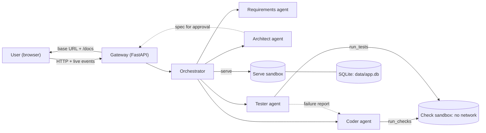

# Mesora Blocks

**PROSIT 2: Plain-Language API Builder** · ICS554 Natural Language Processing · Ashesi MSc Intelligent Computing Systems · Group 3

A non-developer describes a backend in plain words. A team of AI agents built on the **Claude Agent SDK** turns it into a running, tested API with its own SQLite database and a Swagger page to try it out.

```
"I run a small clinic. I need to book patients into appointments."
        │
        ▼
Requirements ──► Architect ──► [user approves the plan] ──► Coder ⇄ Tester
        │
        ▼
http://localhost:8101/docs    running API · tests passing · data saved in SQLite
```

> **Status:** SDK rebuild in progress. Mesora Blocks is a web app only (no desktop version). It runs locally for now, and the full version will be hosted online later (see [Hosting](#hosting-planned)). The first hand-built prototype is archived (see [Baseline](#baseline-the-hand-built-prototype)). Commands below describe the target structure; update this file as parts land.

## Contents

1. [Sample UI](#sample-ui)
1. [What we are building](#what-we-are-building)
2. [Architecture](#architecture)
3. [Sandbox and security](#sandbox-and-security)
4. [Generated APIs and SQLite](#generated-apis-and-sqlite)
5. [Shared contracts](#shared-contracts-day-1-agreements)
6. [Repository layout](#repository-layout)
7. [Getting started](#getting-started)
8. [Team roles](#team-roles)
9. [Milestones](#milestones)
10. [Project checklist](#project-checklist)
11. [Contributing](#contributing)
12. [Course topics in the system](#course-topics-in-the-system)
13. [Hosting (planned)](#hosting-planned)
14. [Deploying](#deploying)
15. [Baseline: the hand-built prototype](#baseline-the-hand-built-prototype)
16. [Known limitations](#known-limitations)

---

## Sample UI

**Mesora Blocks** is the target interface. It comes from the hand-built prototype and is the reference Role 1 builds toward for the SDK version.


*Screenshot from the prototype, which also ran in a desktop window. The SDK version runs in the browser only. The Run view after a build: the API is running in the Docker sandbox on a localhost port, every endpoint can be tried from the left list, and the Assistant panel shows the approved rules and each build step.*

The page has three parts: a sidebar of views, the main panel, and the Assistant panel on the right, which can be toggled.

| View | Shows |
| --- | --- |
| **Home** | Code editor for the generated project |
| **Files** | The project's files in the workspace |
| **Map** | How the API's modules import each other, drawn as layered columns |
| **Tests** | Every test the Tester ran, grouped by file, with the pass count |
| **Search** | Search inside the generated code |
| **Activity** | Every agent step, newest first |
| **Run** (Try it) | Try every action of the API in plain language: actions grouped by data (Create, View, Edit, Delete), a form built from the spec's fields, "Try it as" Anyone / Signed-in user / Admin, and results as a table or a plain-English error. Technical details are one click away. Starts the test copy automatically; **Publish** opens a dialog |
| **Settings** | App settings |
| **Assistant** (panel) | The chat, the spec for approval, the rules in plain English, build progress, and the result card with **View code**, **Download code** and **Try it** |

The project menu at the top switches between generated projects, and **Download code** exports the whole project.

---

## What we are building

| | |
| --- | --- |
| **Input** | A plain-language description of a backend, plus follow-up messages ("actually, patients should only see their own appointments"). |
| **Output** | A running backend where every endpoint works, data persists in SQLite, a Swagger page at `/docs` for trying it, a list of endpoints, and the test results. |
| **Scope** | Backend only. Generating a frontend that uses the API is a future extension. |
| **Class rule** | The browser never talks to an agent directly. Every request goes through our backend, the same way a frontend never queries a database directly. |

---

## Architecture



### Components

| Component | What it does | Built with |
| --- | --- | --- |
| **UI** | Chat, spec approval screen, live build progress, "try it" panel | Static HTML/JS (`ui/`) |
| **Gateway** | Sessions, receives messages, streams events to the UI, proxies everything to the orchestrator | FastAPI + Server-Sent Events |
| **Orchestrator** | Runs the agents in order, handles approval and change requests, enforces stop rules, logs every step | Plain Python state machine |
| **Agents** | Requirements, Architect, Coder, Tester. Each one is its own SDK session with its own prompt, tools and permissions | `claude-agent-sdk` (`ClaudeSDKClient`) |
| **Custom tools** | `submit_spec`, `run_checks`, `run_tests`, `finish_build`, etc. | SDK `@tool`, served as an in-process MCP server |
| **Sandbox** | Runs generated code in locked-down Docker containers | Docker (`sandbox/`) |

### The build flow

1. **Understand.** The Requirements agent chats with the user, one question at a time (with tap-able quick replies), then shows a plain-English summary. The user taps **Looks right** (or says so), and that exact summary becomes the `Requirements`. Off-topic or harmful requests are declined.
2. **Design.** The Architect turns the requirements into a `Spec`: entities, fields, endpoints, access rules and business rules. `submit_spec` validates it against the schema before accepting it.
3. **Approve.** The UI shows the spec in plain English. The user approves or requests a change, which goes back to the Architect. **No code is written before approval.**
4. **Build.** The Coder writes `app/` in the project workspace, calls `run_checks` until everything passes, then calls `finish_build`. The finish gate is enforced in code: `finish_build` is refused until checks have passed since the last file change.
5. **Test.** The Tester writes `tests/` from the **spec, not the code**, runs them, and submits a structured failure report if anything fails.
6. **Fix.** The failure report sends the Coder back into its loop (`MAX_FIX_ROUNDS`, default 1). The Coder cannot edit `tests/`. If a fix round breaks the build, the last working code is restored and the known failures are reported honestly.
7. **Deliver.** The orchestrator starts the API in the serve sandbox and returns a `BuildResult`: base URL, docs URL, endpoint list, test summary and any known failures.

### Single-agent workflow (`PIPELINE=solo`)

The same app can run with **one agent** instead of the team. The chat is unchanged. After **Looks right**, a single agent (`agents/solo.py`) works in one session:

1. It designs the spec and calls `submit_spec`. The spec gets the same checks as the Architect's (`architect.check_spec`) and appears in the chat as it is accepted.
2. It writes `app/` and `tests/test_api.py`. Its file tools are guarded like the Coder's: it can only write in `app/` and `tests/`.
3. It calls `run_tests`, which runs the same pytest run and platform contract tests as the Tester's. It fixes failures and repeats, up to 6 runs.
4. Our code runs the tests one last time. That run is the verdict, not the model's word.

There is **no approval step and no separate tester**. A change request, with its `@` files, or **Rebuild** sends the same agent back to edit the existing project. It clears `change_request` and `change_files` once it has applied them. On an existing project it must **edit in place**: `Write` is refused for files that already exist (`core/sdk.deny_reason`, `edit_in_place=True`), so it uses `Edit` and only the part that needs changing is replaced. The build card lists what changed, e.g. *Changed app/routers/book.py, tests/test_api.py*.

| | Team (`PIPELINE=team`) | One agent (`PIPELINE=solo`) |
| --- | --- | --- |
| After the chat | Architect → you approve → Coder ⇄ Tester | One agent designs, builds and tests |
| Who writes the tests | Tester, from the spec, cannot touch `app/` | The same agent that wrote the code |
| Checks | `check_spec`, contract tests, final pytest run | The same |

`solo` is the default, except with `REQUIREMENTS_AGENT=stub` (the offline replay, used by the hosted site), which stays on the team flow. Henry's `agents/single.py` is a different thing: the bare benchmark baseline, which writes code and tests but can't run them.

A live run (Haiku) built a library app in 77 s in the standard layout (`routers/`, `schemas/`, `services/` per entity, plus README, Dockerfile, requirements): 3 entities, 14 endpoints, 66 of 66 tests passed, about 180k tokens including the chat.

Messages the user sends during a build are queued and shown in the chat ("I'll read this when I'm done"). Today the gateway sends them, joined into one message, when the running job ends: before a spec they go to the Requirements agent, after it they are a change request. Routing them sooner, after the current agent step, is Role 2's.

### Change requests and `@` mentions

After the spec exists, everything the user types is a **change request**. The user can point at a file by typing `@` in the chat box and picking it from the list, e.g. *"In @app/main.py, let patients reschedule"*. The gateway fills two fields:

| Field | Set by | Holds |
| --- | --- | --- |
| `state.change_request` | gateway | The user's words, unchanged (mentions included) |
| `state.change_files` | gateway | The `@`-mentioned paths that really exist in the workspace, in order, no duplicates (e.g. `["app/main.py"]`). Unknown names and email addresses are ignored. |

The Architect revises the spec from `change_request`. The user approves the new spec, and the Coder applies it (see the Role 3 checklist). A new change request overwrites both fields. In the chat, each request appears right after the version it replaced. Earlier versions stay in place, collapsed, with their design and build (the gateway keeps them as `rounds`).

### Inside each agent

The SDK runs the Thought → Action → Observation loop for us. For each agent we supply the system prompt, the tools it may use, permission rules, hooks, and a turn limit.

| Agent | Goal | Tools | Done when |
| --- | --- | --- | --- |
| Requirements | Understand what the user wants | `ask_user` (with quick replies), `propose_summary`, `confirm_summary`, `decline` | The user confirms the summary (**Looks right**); the stored draft, already checked against the schema, becomes `state.requirements` |
| Architect | Turn requirements into a spec | `submit_spec` | Spec validates and the user approves it |
| Coder | Build the API from the spec | `Read`, `Write`, `Edit`, `Glob`, `Grep` (workspace only), `run_checks`, `search_patterns`, `finish_build` | `finish_build` accepted |
| Tester | Find bugs | `Read`, `Write`, `Edit` (`tests/` only), `run_tests`, `submit_report` | All tests pass, or report submitted |

A sketch of how the Coder is configured (Role 3 owns the real version in `agents/coder.py`):

```python
options = ClaudeAgentOptions(
    model=os.getenv("LLM_MODEL", "claude-haiku-5-5"),
    system_prompt=CODER_PROMPT,
    cwd=workspace,                                    # file tools work inside the project
    mcp_servers={"prosit": prosit_tools},             # our custom tools
    allowed_tools=["Read", "Write", "Edit", "Glob", "Grep",
                   "mcp__prosit__run_checks", "mcp__prosit__search_patterns",
                   "mcp__prosit__finish_build"],
    disallowed_tools=["Bash", "WebFetch", "WebSearch"],
    hooks={"PreToolUse": [HookMatcher(matcher="Write|Edit", hooks=[only_app_py])]},
    max_turns=int(os.getenv("MAX_TURNS", 30)),
)
```

### Key decisions

| Decision | Why |
| --- | --- |
| Claude Agent SDK for every agent | Lecturer's advice: use a framework rather than hand-rolling orchestration. The SDK gives us the loop, file tools, permissions and hooks, so we spend our time on the product. One stack for everyone. |
| Plain-Python orchestrator with a fixed order | The approval step, fix rounds and logging need to be predictable and easy to explain in the viva. SDK sessions run inside each step. |
| Fixed generated stack: FastAPI + stdlib `sqlite3` | Fewer choices make the coder more reliable. FastAPI gives Swagger for free. `sqlite3` needs no extra package, so the sandbox still needs no network. |
| Read-only code, no-network check sandbox | Generated code can't call out, modify itself at runtime, or touch the host. |
| SQLite on a separate writable volume | Data survives restarts, and `data/` is the only writable place. |
| Tests written from the spec; Coder can't edit them | Stops the Coder from "passing" by changing the tests. |
| Finish gate in code, not just in the prompt | The model can't declare itself done without passing checks. |
| Web app only, no desktop version | One codebase that runs locally now and can be hosted online later without changes to the UI. |
| Agents are never exposed to the browser | Same reasoning as never letting a frontend talk to a database. |

---

## Sandbox and security

### Container limits

| | Check sandbox (`run_checks`, `run_tests`) | Serve sandbox (running API) |
| --- | --- | --- |
| Network | `none` | Port bound to `127.0.0.1` only. Blocking outbound traffic is a TODO (Role 3). |
| Code (`/work`) | Read-only mount | Read-only mount |
| Data (`/data`) | None. Tests use a throwaway DB on `/tmp` | Read-write mount of `workspace/<project>/data/` |
| Filesystem | `--read-only`, `tmpfs` on `/tmp` | `--read-only`, `tmpfs` on `/tmp` |
| Memory / CPU / PIDs | 512 MB / 1 CPU / 128 | 512 MB / 1 CPU / 128 |
| User | Non-root `runner` | Non-root `runner` |
| Time limit | 120 s per run | Stopped when the session ends or after an idle timeout |

`SANDBOX=local` runs checks as a plain subprocess for machines without Docker. **It is not isolated.** Use it for quick development only, never for the demo.

### Agent permissions

- `Bash`, `WebFetch` and `WebSearch` are disabled for every agent. Agents run code only through our sandbox tools.
- A `PreToolUse` hook enforces paths: the Coder may write only `app/**/*.py`, the Tester only `tests/**/*.py`, and nobody writes outside the project workspace.
- The API key lives only in the gateway's environment. It is never written to a workspace or mounted into a container.
- User text is data, not instructions. Requirements and specs are passed into prompts as quoted content, and no agent can change its own tools or permissions.
- Generated APIs use `sqlite3` with parameterised queries only, never string-built SQL.

---

## Generated APIs and SQLite

Every generated project has the same layout. The Coder writes `app/`, the Tester writes `tests/`, and our code writes the rest.

It is enforced, not just suggested. `core/layout.py` holds:
- **`LAYOUT`:** the rules as the coding agent reads them in its prompt.
- **`check()`:** reports missing files, files not named after an entity, and endpoint handlers left in `main.py`. The agent gets these back with its test results and fixes them like failing tests.
- **`tidy()`:** removes files the agent emptied, because it has no delete tool.
- **`scaffold()`:** after every build, writes `spec.json`, `README.md` (how to run it, endpoints, rules), `requirements.txt`, `Dockerfile` and `.gitignore`.

```
workspace/<project>/
├── spec.json                 # approved spec (written by the orchestrator)
├── app/
│   ├── main.py               # creates `app = FastAPI(...)`, includes routers, creates tables on startup, GET /health
│   ├── database.py           # SQLite connection and table setup
│   ├── dependencies.py       # header-based auth (X-Role, X-User-Id)
│   ├── schemas/<entity>.py   # <Entity>Create, <Entity>Update, <Entity>
│   ├── routers/<entity>.py   # one APIRouter per resource, thin handlers
│   └── services/<entity>.py  # business rules (when the spec has them)
├── tests/                    # Tester only
├── data/app.db               # SQLite file (serve sandbox only, gitignored)
├── README.md, requirements.txt, Dockerfile, .gitignore   # scaffolded by us (core/layout.py)
```

Conventions for `app/database.py`:

```python
import os, sqlite3

DB_PATH = os.getenv("DATABASE_PATH", "/data/app.db")   # tests set /tmp/test.db

def get_conn() -> sqlite3.Connection:
    conn = sqlite3.connect(DB_PATH)
    conn.row_factory = sqlite3.Row
    conn.execute("PRAGMA foreign_keys = ON")
    return conn
```

**Every generated API has a health check.** `GET /health` returns `200 {"status": "ok"}`, needs no auth, and is not part of the spec (the platform adds it, so users never have to ask). When the API uses SQLite it runs `SELECT 1` first and returns `503 {"status": "error"}` if the database can't be reached. The platform depends on it: the gateway waits for `/health` before it marks an API as running or published, and refuses an API that doesn't answer it. The golden clinic has one.

Other conventions the Tester relies on: exact methods and paths from the spec, the spec's success status code, `401` for missing or invalid auth, `403` for a user calling an admin endpoint, `404` for unknown ids, `409` for conflicts, `422` for invalid input, ids assigned by the server, and only `fastapi`, `pydantic` and the standard library.

---

## Shared contracts (Day 1 agreements)

These are what let four people build separately and still fit together. **Changing any of them needs approval from all four members.**

| Contract | Where | What it fixes |
| --- | --- | --- |
| `ProjectState` | `core/state.py` | The single object passed between agents: chat, requirements, spec, approval flag, change request and the files it mentions (`change_files`), tasks, workspace, build/test status, logs |
| `Requirements`, `Spec` | `core/spec.py` | Data, endpoints, access rules and business rules |
| Agent format | every `agents/*.py` | `async def run(state: ProjectState, emit: Emit) -> ProjectState`. Each agent appends at least one `LogEntry`. |
| Event format | `core/events.py` | `{"type": "status" \| "step" \| "spec" \| "test" \| "result" \| "error", "agent": str, "detail": str, "data": {}}`, streamed to the UI |
| Tool format | `core/sdk.py` | Each agent defines its tools as Python functions; `run_agent()` serves them as one in-process MCP server named `prosit`. Agents see them as `mcp__prosit__<name>`. |
| Failure report | `core/spec.py` | List of `Failure` `{endpoint, test, expected, got, hint}` from Tester to Coder, in `state.failures` (and as text in `state.test_report` for the UI) |
| `BuildResult` | `core/state.py` | `base_url`, `docs_url`, `endpoints`, `test_summary`, `known_failures`. Set by the orchestrator in `state.result`; the gateway adds the URLs when the API starts |

### Golden example

`golden/clinic/` is a hand-written, known-good project: chat transcript, requirements, spec, FastAPI code with SQLite, and tests. Every role builds and tests their part against it first, so nobody waits for anybody.

---

## Repository layout

```
.
├── agents/
│   ├── requirements.py      # Role 1
│   ├── architect.py         # Role 2
│   ├── orchestrator.py      # Role 2
│   ├── single.py            # Role 2: single-agent mode, the baseline for the evaluation
│   ├── coder.py             # Role 3
│   └── tester.py            # Role 4
├── core/
│   ├── state.py             # ProjectState, LogEntry, BuildResult
│   ├── spec.py              # Requirements, Spec, FailureReport
│   ├── events.py            # event format + emit helper
│   ├── sdk.py               # shared ClaudeAgentOptions builder, logging/cost hooks
│   ├── tools.py             # custom tools (in-process MCP server)
│   ├── sandbox.py           # docker run for checks, tests and serving
│   └── scaffold.py          # README, requirements.txt, Dockerfile for generated projects
├── server/                  # gateway: sessions, messages, SSE; stubs.py stands in for unfinished agents
├── ui/                      # Mesora Blocks frontend (static), served by the gateway
├── docs/screenshots/        # images used in this README
├── sandbox/                 # Dockerfile + check.py
├── rag/                     # pattern library, docs index, search tool (Role 4)
├── golden/clinic/           # golden example
├── benchmark/               # scenarios + hidden tests (Role 4)
├── eval/                    # benchmark runner, results to CSV
├── tests/                   # tests for our own code
├── workspace/               # generated projects (gitignored)
├── run.py                   # CLI entry point
├── requirements.txt
└── .env.example
```

---

## Getting started

### Prerequisites

- Python 3.10+
- Docker (running)
- [Claude Code](https://docs.claude.com/en/docs/claude-code) installed and logged in with **your own Claude subscription** (Pro, Max or Team). No API key needed for local work: see [Signing in to Claude](#signing-in-to-claude)
- Git

### Setup

```bash
git clone https://github.com/ASU-MICS-2028/nlp-group-3-prosit-2.git
cd nlp-group-3-prosit-2
python -m venv .venv && source .venv/bin/activate     # Windows: .venv\Scripts\activate
pip install -r requirements.txt
docker build -t prosit-sandbox sandbox/
cp .env.example .env                                   # no key needed for local work
claude                                                 # once: log in with your Claude subscription, then /status to check
```

`.env`:

```bash
# ANTHROPIC_API_KEY=sk-ant-...   # leave unset locally: if set, it is used (and billed) instead of your subscription
LLM_MODEL=claude-haiku-5-5      # cheap for development; use claude-sonnet-5-5 for demos and benchmark runs
MAX_TURNS=30                    # per agent session
MAX_FIX_ROUNDS=1
PIPELINE=solo                   # solo: one agent builds after the chat | team: architect, approval, coder, tester
SANDBOX=docker                  # docker | local (local is NOT isolated)
SERVE_PORT_RANGE=8100-8199
PUBLISH_URL=http://{sub}.localhost:8000   # where published APIs live; hosted: https://{sub}.your-domain
```

### Run

```bash
python -m server                            # web app at http://localhost:8000 (stub agents for now)
python run.py --golden clinic               # full pipeline on the golden example
python run.py "I run a small clinic..."     # full pipeline from a prompt, in the terminal
python run.py --stop-all                    # stop every running generated API
```

### Test

```bash
pytest                                      # offline: no API calls, agents use recorded replies
pytest -m live                              # real API calls (costs money)
python -m eval.benchmark --out results/run.csv
```

### Signing in to Claude

The agents run on the Claude Agent SDK, which signs in the same way Claude Code does.

| Where | How | Why |
| --- | --- | --- |
| **Your laptop** (development, tests, benchmark runs, the live demo) | Your own Claude subscription: run `claude` once and log in. Usage counts against your plan's limits; no per-token charge | Your own work on your own machine is ordinary subscription use |
| **The hosted site** (mesorablocks.online) | An API key (`ANTHROPIC_API_KEY` in Coolify). Until we have one, it runs with `REQUIREMENTS_AGENT=stub` (the golden replay) | Anthropic's terms: products that serve other people's requests must use API key authentication, not a subscription login (that includes `claude setup-token`) |

- **`ANTHROPIC_API_KEY` wins.** If it is set in your environment, the SDK uses it and bills the API instead of your subscription. Keep it unset locally; `/status` in Claude Code shows which sign-in is active.
- **No pay-as-you-go budget?** Max and Team plans include monthly API credits that can be claimed into a Claude Console organization and used through an API key (Pro does not). That is the way to switch the hosted site to the real agents without card billing: put the key in Coolify and delete `REQUIREMENTS_AGENT`. No code changes.
- Each agent turn has a cost cap (`MAX_TURN_USD`, default $0.10), which also limits how fast a turn can use up plan limits.

### Keeping costs down

Use Haiku for day-to-day work and Sonnet only for demos and benchmark runs. Keep `MAX_TURNS` low while developing, and run `pytest` (offline) before `pytest -m live`. `core/sdk.py` logs tokens and cost per step, so check the logs after a live run.

---

## Team roles

| Role | Member | Builds | Course topics owned | Theory topic taught | Starts from |
| --- | --- | --- | --- | --- | --- |
| 1. Interface & Requirements | Eugene Sewor ([@eugene-sew](https://github.com/eugene-sew)) | Gateway, UI, requirements agent, approval screen, "try it" panel | Human-in-the-loop, prompt engineering & CoT, memory, alignment | Instruction tuning | Golden chat + spec |
| 2. Orchestrator & Architect | Henry Brandoh ([@henryhkb](https://github.com/henryhkb)) | Orchestrator, shared SDK setup, architect agent, logging | Orchestration, multi-agent, agentic AI, reasoning & planning, decomposition | Preference learning (incl. DPO) | Golden chat |
| 3. Coder & Sandbox | Heny Olletey ([@henryolletey](https://github.com/henryolletey)) | Coder agent, permissions and hooks, sandbox, SQLite volume, security | Coding agents, ReAct, tool use, MCP, privacy & security | RLHF | Golden spec |
| 4. Tester, RAG & Evaluation | Liza Ndede ([@lnaikins](https://github.com/lnaikins)) | Tester agent, RAG, benchmark, comparisons | Self-reflection, RAG, evaluation | LLM alignment | Golden code + tests |

### Role 1: Interface & Requirements

**Set up**
- [x] Write the golden chat transcript
- [ ] Define the plain-English labels for the user-facing parts of the spec

**Build** (match the [sample UI](#sample-ui))
- [x] Gateway: create session, post message, SSE event stream
- [x] Port the Mesora Blocks UI from the prototype onto the new gateway and event format
- [x] Assistant panel: chat, spec approval (Approve / Request change), build progress from events, result card
- [x] Requirements agent on the SDK: plain language, one question at a time, quick replies, summary confirmed in code (`agents/requirements.py`)
- [ ] Short-term memory: chat history, summarised when long
- [x] Guardrails: stay on topic, flag unsafe requests (`decline` tool; user text is quoted data)
- [x] Run view: start/stop, open docs, try any endpoint; auth fields generated from the spec's access rules
- [x] Tests and Activity views fed from the Tester's results and the step log
- [x] Files, Map, Search and Home (editor) views on the generated workspace
- [x] Phone layout: one screen at a time, floating tab bar (Chat, Try it, Tests, Code, More), bottom sheets, works down to iPhone SE
- [x] Installable app (PWA): manifest with maskable icons, service worker, offline page, Install button (Chrome/Edge/Android) and Add to Home Screen steps (iPhone/iPad)
- [x] Queue and display messages sent during a build (sent when the running job ends)
- [x] `@` mentions: pick a workspace file in the chat box; the gateway puts it in `state.change_files`
- [x] Publish: the user picks a subdomain and gets a permanent URL for the built API (gateway routes by host)
- [x] Deploy to the server with a domain (Coolify, mesorablocks.online, HTTPS per published subdomain)
- [ ] Publish hardening: public traffic through the serve sandbox, real sign-in, per-user limits

**Connect**
- [ ] Gateway ↔ orchestrator (with Role 2)
- [ ] Agree the event format (with Roles 2 and 3)

**Evaluate**
- [ ] Usability test with 3–5 non-developers (SUS scores)
- [ ] Count clarifying turns per scenario
- [ ] Section B: interface and human-in-the-loop

### Role 2: Orchestrator & Architect

**Set up**
- [x] Lead `ProjectState`, agent format and event format (`Failure` and `BuildResult` added)
- [x] Write the golden spec

**Build**
- [x] `core/sdk.py`: shared `run_agent()` with model, turn and cost limits; file tools locked to the project by a `PreToolUse` hook. Tokens, cost and time are logged per step
- [x] Orchestrator: requirements → architect → approval → coder ⇄ tester (`agents/orchestrator.py`; serving stays in the gateway)
- [x] Stop rules: max fix rounds, restore last working code
- [x] Architect agent on the SDK with `submit_spec` validating against the schema (`agents/architect.py`)
- [x] Split the spec into build tasks for the Coder (`plan_tasks()`)
- [ ] Route change requests (from the approval screen and mid-build messages) back to the Architect: approval screen done; mid-build messages not yet
- [x] Single-agent mode (one SDK session does everything) for comparison (`agents/single.py`, `orchestrator.build_single()`)
- [x] Write every step to a JSONL log (`<project>/steps.jsonl`)

**Connect**
- [ ] Wire all agents (with Roles 1 and 3)
- [ ] Full pipeline run on the golden example

**Evaluate**
- [ ] Compare generated specs with reference specs
- [ ] Hand logs to Role 4
- [ ] Architecture diagram for Section B and slides

### Role 3: Coder & Sandbox

**Set up**
- [ ] Update the golden FastAPI code to SQLite
- [ ] Sandbox image and data volume

**Build**
- [ ] Check sandbox: no network, read-only code, throwaway DB, 120 s limit
- [ ] Serve sandbox: read-only code, writable `data/`, localhost port, port allocation, idle stop
- [ ] Block outbound network for the serve sandbox
- [ ] Coder agent on the SDK: prompt with layout and SQLite conventions (reuse `core/layout.LAYOUT` in the prompt and `layout.check()` in `run_checks`, as `agents/solo.py` does)
- [ ] Coder always adds `GET /health` (checks the database when there is one); `run_checks` fails without it
- [ ] Permissions: disable `Bash`/`WebFetch`/`WebSearch`, `PreToolUse` path hook
- [ ] Custom tools: `run_checks`, `finish_build` (finish gate)
- [ ] Check the generated OpenAPI matches the spec
- [ ] Change requests: when `state.change_request` is set, change only what it asks for and keep the rest of the working code. Open the files in `state.change_files` first: the user pointed at them. See [Change requests and `@` mentions](#change-requests-and--mentions).
- [ ] Stretch: MCP server exposing the finished API's spec
- [ ] Document security risks and mitigations

**Connect**
- [ ] Coder ⇄ Tester failure-report loop (with Role 4)
- [ ] Coder ↔ orchestrator (with Role 2)

**Evaluate**
- [ ] Security checklist per scenario
- [ ] Build success rate, steps and tokens per build
- [ ] Section B: coder, sandbox, security

### Role 4: Tester, RAG & Evaluation

**Set up**
- [ ] Write the golden tests (against a throwaway SQLite DB)
- [ ] Write 15–30 benchmark scenarios
- [ ] Write hidden tests for each scenario

**Build**
- [x] Tester agent on the SDK: tests from the spec, writes only `tests/`, `run_tests`, `submit_report`
- [x] Contract tests always check `GET /health` → `200 {"status": "ok"}` without auth
- [ ] Agree the failure-report format with Role 3
- [ ] RAG: pattern library (FastAPI + `sqlite3` patterns) and FastAPI docs, chunked and embedded
- [ ] `search_patterns` tool for the Coder
- [ ] Spec checking with Schemathesis
- [ ] Evaluation script that saves results to CSV
- [ ] Model comparison experiment (e.g. Haiku vs Sonnet)

**Connect**
- [ ] Tester ⇄ Coder loop (with Role 3)

**Evaluate**
- [ ] Run the benchmark on the full system
- [ ] Comparisons: no tester, single agent, no RAG, hand-built baseline vs SDK
- [ ] Results tables and charts
- [ ] Section B: evaluation

### Everyone

- [ ] Teach your theory topic
- [ ] Review a teammate's code each week
- [ ] Present at the weekly teach-back
- [ ] Write your own Section A
- [ ] Present your part in the presentation
- [ ] Be able to explain the whole system for the viva

---

## Milestones

Fill in the dates once the deadline is confirmed.

| # | Milestone | Done when | Owner | Target date |
| --- | --- | --- | --- | --- |
| M0 | Kick-off | Roles assigned, deadline confirmed, dates in this table | All | |
| M1 | Contracts & golden example | Contracts merged; golden clinic (SQLite) passes its own tests in the sandbox | All | |
| M2 | Walking skeleton | UI → gateway → orchestrator → stub agents → fake `BuildResult` shown in the UI | Roles 1, 2 | |
| M3 | Each part alone | Every agent runs on golden input through the SDK and returns valid output | Each role | |
| M4 | Pairs connected | Requirements → Architect works; Coder ⇄ Tester loop works | Pairs | |
| M5 | End to end | Golden clinic goes from chat to a running API with SQLite and Swagger, all tests passing | All | |
| M6 | Benchmark | Full benchmark run, results CSV, success rate reported | Role 4 | |
| M7 | Hardening & usability | Usability test done, security checklist done, fixes merged | Roles 1, 3 | |
| M8 | Write-up & demo | Four Section A's, Section B, slides, rehearsed demo | All | |

---

## Project checklist

- [x] Create the GitHub repo
- [x] Hand-built prototype (archived as the baseline)
- [x] Assign roles
- [ ] Confirm the deadline and fill in milestone dates
- [ ] Day 1 agreements merged
- [ ] Golden example updated to SQLite
- [ ] Walking skeleton runs end to end
- [ ] Each part runs alone on the golden example
- [ ] Pairs connected
- [ ] Full pipeline runs end to end
- [ ] Benchmark results ready
- [ ] Usability test done
- [ ] Security checklist done
- [ ] Section A (×4), Section B and slides done (repo link on page 1 of both)
- [ ] Demo rehearsed

---

## Contributing

### Branches

- `main` must always run end to end. Never push directly to it.
- Feature branches: `feat/r<role>-<topic>`, e.g. `feat/r3-sqlite-volume`, `feat/r1-approval-screen`.
- Fixes: `fix/<topic>`.

### Pull requests

1. Keep PRs small and merge often. A long-lived branch is an integration problem waiting to happen.
2. `pytest` (offline) must pass. If you changed an agent, also run `python run.py --golden clinic` and paste the result summary in the PR.
3. If you changed a prompt, say so in the PR description. Prompt changes move benchmark numbers.
4. One approving review from your review partner before merging.
5. **Contract changes** (`core/state.py`, `core/spec.py`, `core/events.py`, tool names) need approval from all four members.

### Review ring

1 → 2 → 3 → 4 → 1, then switch halfway: 1 → 3, 2 → 4, 3 → 1, 4 → 2. Pair program whenever you connect two parts.

### Commit messages

Imperative, prefixed with the area: `coder: block writes outside app/`, `ui: show test summary on result card`.

### Never commit

API keys or `.env`, anything under `workspace/`, SQLite files, benchmark results with personal data.

### Rhythm

Weekly teach-back: 10 minutes per owner, others ask viva-style questions. Section A is individual and in your own words. Section B is shared.

---

## Course topics in the system

| Topic | Where it lives |
| --- | --- |
| Agentic AI | Each agent is an LLM in a loop with tools, memory and a stop rule |
| ReAct (Thought → Action → Observation) | The SDK's agent loop inside every agent; visible in the step logs |
| Tool use | SDK built-in file tools plus our custom tools |
| MCP | Our custom tools are served as an in-process MCP server |
| Multi-agent systems | Four specialised agents |
| Orchestration | `agents/orchestrator.py` |
| Reasoning & planning | Architect produces the spec and build tasks before any code |
| Decomposition | Spec split into per-resource build tasks |
| Self-reflection | Tester failure reports send the Coder back into its loop; `run_checks` feedback |
| Memory | `ProjectState` as shared memory; chat history and summaries; RAG pattern library |
| Human-in-the-loop | Spec approval and change requests |
| Coding agents | The Coder |
| Privacy & security | Sandbox limits, permissions, path hooks, secret handling |
| RLHF / alignment | Taught, not built: explains why a post-trained model follows tool formats and instructions |

---

## Hosting (planned)

For development and the demo, everyone runs the web app locally (`python -m server`). After that, the full version will be hosted online so anyone can use it from a browser. Hosting changes a few things, so keep them in mind while building:

| Concern | Local now | Hosted later |
| --- | --- | --- |
| Where it runs | Your machine | A server (VM) that can run Docker, because the sandbox needs it. Serverless platforms will not work. |
| Generated APIs | `http://localhost:81xx/docs` | Reached through the gateway (for example `/p/<project>/docs`). Serve containers stay bound to `127.0.0.1` and are never exposed directly. |
| Users | One person, no login | Sign-in, with each user's projects kept separate |
| API cost | Your own key | One server key, so builds need per-user limits (turns, tokens, builds per day) |
| Builds | One at a time | Queued per user, with idle serve containers stopped |
| Connection | HTTP | HTTPS |
| Published APIs | `http://<name>.localhost:8000` (browsers resolve `*.localhost` to this machine, no setup) | `https://<name>.<our-domain>`: one wildcard DNS record and a wildcard TLS certificate pointing at the gateway |

Practical rule for now: never hard-code `localhost` URLs in the UI or the `BuildResult`. Build them from the gateway's base URL so hosting needs no rewrite.

### Publishing

After a build, the user can **publish** the API from the Run view: they pick a subdomain (3–32 lowercase letters, numbers or dashes; names like `www` and `api` are reserved) and get a permanent URL from `PUBLISH_URL`. The gateway keeps a snapshot of the built `app/` in `workspace/_published/<name>/`, runs it, and routes every request whose host is `<name>.<domain>` to it, with no session cookie. Published APIs restart with the gateway, and rebuilding a project doesn't change its live API until the user clicks **Update**. One subdomain per project; renaming moves it.

Owned by Role 1. Before it is opened to the public: real sign-in (today the browser session owns the name), published APIs running in the serve sandbox (Role 3), and limits on how many APIs each user can publish.

---

## Deploying

Live at **https://mesorablocks.online** (Role 1 owns this). Published APIs live at `https://<name>.mesorablocks.online`.

| Piece | Where |
| --- | --- |
| Server | Hostinger VPS running Coolify (Traefik v3 as the proxy) |
| App | Coolify application `mesora-blocks`, built from this repo's `Dockerfile`. Network alias `mesora-blocks` |
| DNS | `mesorablocks.online` and `*.mesorablocks.online` → the server (A records at Hostinger) |
| HTTPS | Coolify issues the certificate for the main domain. Each published API gets its own Traefik route file (`mesora-<name>.yaml`), so Let's Encrypt issues its certificate on the first visit; no wildcard certificate or DNS API needed |
| Data | Persistent volume at `/data/workspace` (projects and published snapshots) |

Settings in Coolify: `REQUIREMENTS_AGENT=stub` until there is an API key (see [Signing in to Claude](#signing-in-to-claude)), `PUBLISH_URL=https://{sub}.mesorablocks.online`, `TRAEFIK_DYNAMIC_DIR=/traefik-dynamic` (mounted from `/data/coolify/proxy/dynamic/mesora`), `TRAEFIK_SERVICE_URL=http://mesora-blocks:8000`.

Traefik only watches the top level of its dynamic folder, so the app writes routes into its own subfolder and a small systemd watcher copies `mesora-*.yaml` files up (and removes them on unpublish). It touches nothing else. Install it once on the server as root:

```bash
git clone https://github.com/ASU-MICS-2028/nlp-group-3-prosit-2.git /tmp/mesora && cd /tmp/mesora/deploy && sh install-routes.sh
```

To redeploy, push to the branch Coolify builds from, or press **Redeploy** in Coolify.

---

## Baseline: the hand-built prototype

The first prototype used hand-written ReAct loops, a custom LLM wrapper (Gemini or Claude), in-memory storage and the same locked-down sandbox. It is archived on the `feat/agent-pipeline` branch and is no longer maintained.

It stays useful in two ways: reading it shows what the SDK now does for us, and Role 4 uses it as the baseline in the "hand-built vs SDK" comparison.

---

## Known limitations

- Header-based auth (`X-Role`, `X-User-Id`) is for demonstration only. It is not real authentication.
- The serve sandbox does not yet block outbound network traffic.
- `SANDBOX=local` gives no isolation.
- Builds run one at a time per gateway at first.
- The deployed app still uses stub agents, and generated APIs run as plain processes inside the app container until the serve sandbox lands.
